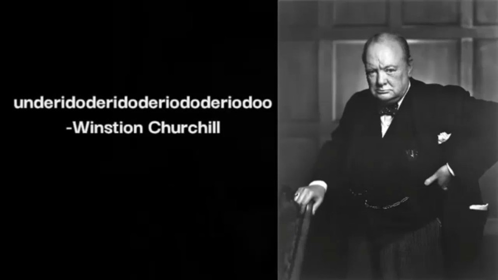

# Лабораторная работа №1

---
**ФИО**: Плохин Дмитрий Сергеевич

**Группа**: 6403

**Научный руководитель**: Бибиков Сергей Алексеевич

**Любимая фраза Уинстона Черчилля**: underidoderidoderiododeriodoo

## Лабораторная работа №2 — многостраничный сайт на HTML и CSS

**Цель:** изучение основ HTML и CSS.

**Тема:** сайт-портфолио Java Backend-разработчика.

**Что сделано:**
- 4 страницы: главная, проекты, навыки, обо мне — связаны общей навигацией;
- на главной — 3D-сцена на чистом CSS (`transform`, `perspective`): фигуры левитируют, фонарь светит, камера поворачивается вслед за курсором;
- страница проектов — карточки со схемами (SVG) и фильтр по технологиям через радиокнопки;
- страница навыков — таблица с выравниванием по левому краю, по центру и по правому краю, линия времени;
- адаптивная вёрстка для телефона, учтена настройка «уменьшить движение».

**Технологии:** HTML, CSS.

**Как открыть:** открыть `lab2/index.html` в браузере.

## Лабораторная работа №3 — основы JavaScript

**Цель:** изучение основ JavaScript.

**Что сделано:** реализован набор функций в `lab3/src/core.js` по каркасу [js-tasks](https://github.com/teach-kirshdv/js-tasks): работа с числами, циклы и рекурсия, замыкания, сравнение объектов.

**Технологии:** JavaScript, Node.js, Mocha.

**Как запустить тесты:** в папке `lab3` выполнить `npm install`, затем `npm test`.

## Лабораторная работа №4 — современный CSS и ООП в JavaScript

**Цель:** изучение современного CSS и основ объектно-ориентированного программирования на JavaScript.

**Тема:** модернизация сайта-портфолио из ЛР №2.

**Что сделано:**
- сайт дополнен пятой страницей «Связь» с формой обратной связи: имя, почта, тема, сообщение и согласие на обработку данных;
- используются Flexbox и Grid для размещения блоков и карточек, включая адаптивную вёрстку;
- цвета оформлены через CSS-переменные, сохранены 3D-сцена и анимации на CSS, добавлена анимация на странице связи;
- создан класс `ContactRequest` с конструктором и методом `printToConsole()` для форматированного вывода введённых данных в консоль;
- при отправке формы объект создаётся в JavaScript, а данные передаются через `fetch()` методом POST на локальный сервер `server.js`;
- для элементов формы применены классы по методологии БЭМ.

**Технологии:** HTML, CSS (Flexbox, Grid, анимации), JavaScript, Node.js.

**Как запустить:** в папке `lab4` выполнить `node server.js`, затем открыть `http://localhost:3000`. Для проверки вывода объекта открыть консоль браузера и отправить форму на странице «Связь». Сервер используется для демонстрации HTTP-запроса и не отправляет письма на почту.
